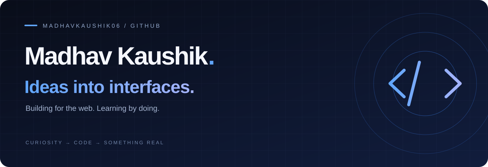

  
  

### A little about me

I'm **Madhav**, a MacEwan University student based in Edmonton. I'm building my skills in **Python, web development, and cloud computing**, and turning that learning into practical projects.

[Connect with me on LinkedIn ↗](https://www.linkedin.com/in/madhav-kaushik-b6a752211/)

### Selected work

| Project | What you'll find |
| :--- | :--- |
| **[01 / DiplomaSpark ↗](https://github.com/madhavkaushik06/diplomaspark)** | An interactive study experience with course units, practice questions, hints, and progress tracking. Built with Next.js, React, TypeScript, and Framer Motion. |
| **[02 / Personal portfolio ↗](https://github.com/madhavkaushik06/madhav-portfolio)** | The source behind my personal portfolio. A space for my work and the next things I build. |

### Learning & credentials

- **CS50’s Programming with Python** — Harvard University
- **PCEP: Certified Entry-Level Python Programmer** — Python Institute
- **Cloud Computing Core** — IBM
- **Introduction to AWS Cloud Careers** — Amazon Web Services

### In the toolkit

---

LEARN SOMETHING. BUILD SOMETHING. MAKE IT BETTER.

